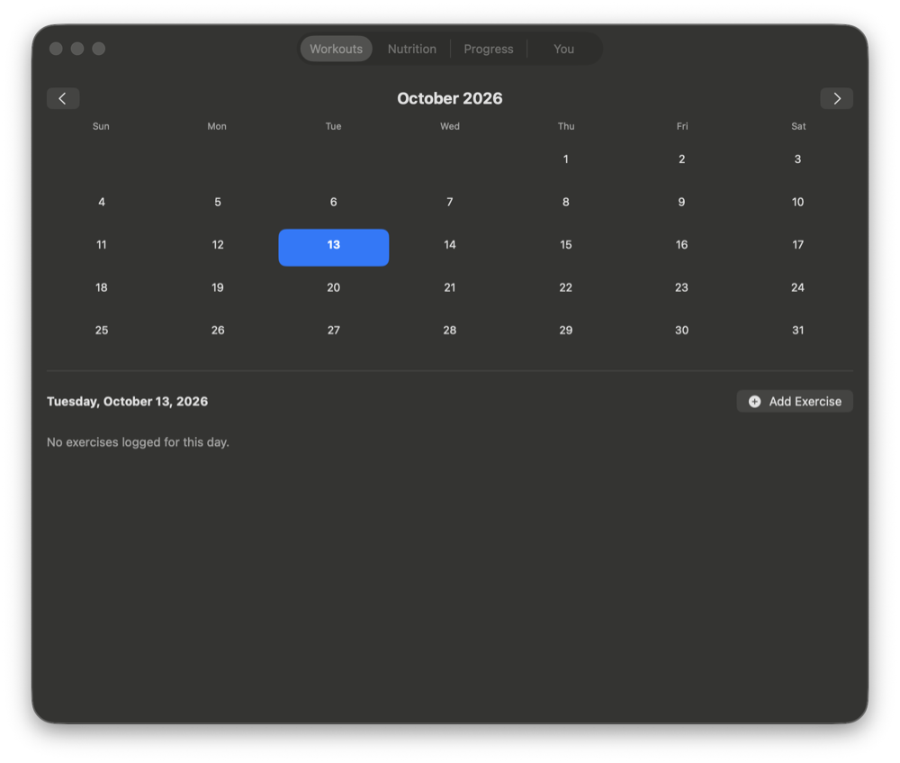

# Fitness & Nutrition Tracker

A macOS app for logging workouts and meals, seeing which muscles you trained, and tracking progress against goals worked out from your profile. Everything is saved locally as JSON.

## Screenshot

## Features

**Workouts**
- **Calendar**: pick a day to see or log its exercises.
- **Exercise library**: push, pull, legs, core, cardio and full-body exercises, each tagged with its primary and secondary muscles.
- **Sets**: reps and weight for every set.
- **Muscles worked**: per-muscle volume for the day (primary muscles get full credit, secondary muscles half) and the total volume.

**Nutrition**
- **Food log by meal**, from a built-in food list or your own custom foods.
- **Daily totals**: calories, protein, carbs and fat against your goals.
- **Water tracker** in cups.
- **7-day averages**.

**Progress**
- **Charts per exercise**: max weight and volume over time.

**You**
- **Profile**: height, weight, age and activity level.
- **Suggested goals** from Mifflin–St Jeor and your activity level (BMR and TDEE shown), which you can override with your own.

## Getting started

Open `p.xcodeproj` in Xcode and press Run.

## Your data

Workouts, food logs and your profile are stored as JSON files in your Documents folder. Nothing is uploaded.
